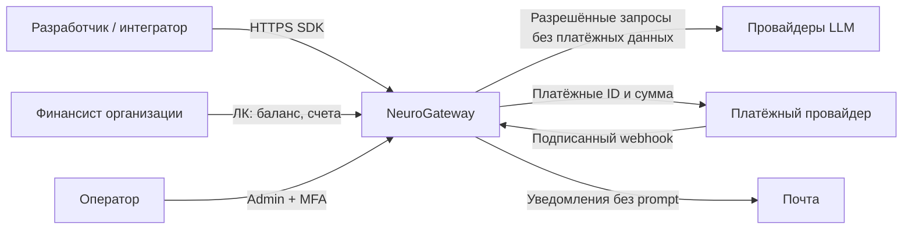
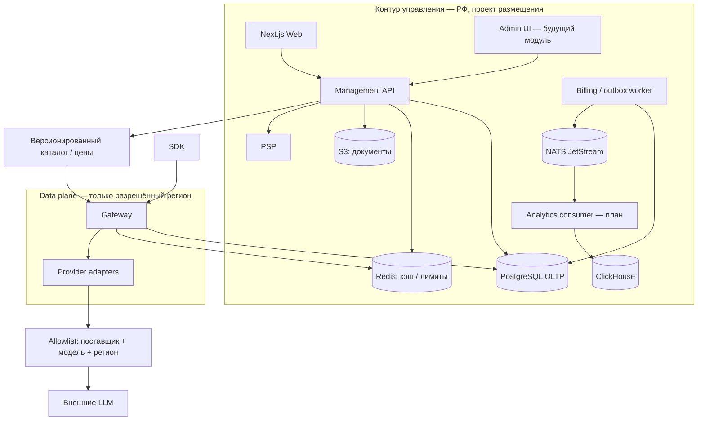

# Архитектура NeuroGateway — 15.10.2026

Связанные задачи: ID24_API-21–26, 31, 36. Это проект целевой архитектуры. Исполняемый срез сейчас: healthz сервисов, детерминированный mock, контракты и SQL. Gateway не выполняет авторизацию, hold/capture и реальные запросы: бизнес-маршруты явно отвечают 501. Командная защита архитектуры ещё не проведена.

## C4 L1 — контекст

## C4 L2 — контейнеры и границы

В production это отдельные процессы/права, а не публичные прямые подключения к БД. В Compose всё локально; эта схема не доказывает регион размещения. Внешние endpoints по умолчанию выключены до юридического допуска.

## C4 L3 — компоненты Gateway

```mermaid
flowchart LR
  ingress[HTTP / SSE] --> auth[Auth + tenant context]
  auth --> policy[Validation / capability / limits]
  policy --> router[Router + price snapshot]
  router --> reserve[Wallet lock + hold transaction]
  reserve --> adapter[Provider adapter + cancellation]
  adapter --> usage[Usage normalizer]
  usage --> capture[Capture / release + immutable journal]
  capture --> outbox[Transactional outbox]
  adapter --> stream[SSE response writer]
  outbox --> relay[Relay: publish + ack]
  relay --> nats[NATS JetStream]
  nats --> analytics[Idempotent analytics consumer]
```

Новый запрос получает generation_id и tenant_id. До внешнего вызова в одной транзакции фиксируются идемпотентность, версия цены и hold. На ответе нормализуется usage; capture и outbox коммитятся вместе. При исключении/отмене выполняется release либо reconcile, если провайдер мог уже списать средства. Не повторять генерацию после первого отправленного токена. Повторная доставка события не означает повторного списания. Этот алгоритм — требование к следующей реализации, а не свойство текущего Python-прототипа.

## Размещение и потоки данных

| Класс | Где хранится | Выход за контур |
|---|---|---|
| Идентичности, реквизиты, кошельки | PostgreSQL в выбранном RU регионе | Только необходимые PSP поля |
| Prompt / completion | Память запроса, по умолчанию не журналируются | Только явно допущенному endpoint; согласие и договор проверяются отдельно |
| Usage / цена / generation ID | PG, затем CH | Обезличенные технические метрики |
| Ключи поставщиков | Будущий secrets manager, отдельные service identities | Только заголовок выбранного адаптера, никогда в логи |
| Документы | Закрытый S3 + короткие подписанные ссылки | Авторизованный пользователь своей организации |

## Отказы и деградация

| Компонент | Поведение / восстановление |
|---|---|
| PostgreSQL | Прекратить платные вызовы до резерва; незавершённые generation сверить после восстановления |
| Redis | Финансовая истина остаётся PG; безопасный отказ ограничениям, пока нет проверенного fallback |
| NATS | PG outbox накапливается; alarm по возрасту, capture не зависит от доступности CH |
| ClickHouse | Отложенная аналитика, баланс берётся из PG; replay по event_id |
| S3 | Генерации доступны, выдача документов 503; ретраи загрузок идемпотентны |
| PSP | Новые пополнения приостановлены; имеющийся баланс доступен; webhook сохраняется до ack |
| Provider | Circuit breaker и ограниченный retry до первого токена; цена fallback явно разрешена клиентом |
| Gateway | SSE закрывается; disconnect отменяет upstream; reconcile не теряет usage |

Решения: [ADR-001](adr-001-stack.md), [ADR-002](adr-002-storage.md), [ADR-003](adr-003-cloud.md), [модель данных](data-model.md), [контракты](contracts.md), [NFR](../quality/nfr.md).

## Решение по поручению пользователя

Принято от имени Ильи по поручению заменить ожидавшуюся командную проверку асинхронным разбором; факта встречи не утверждается. [Проверка](../delivery/review-2026-10-15.md).
