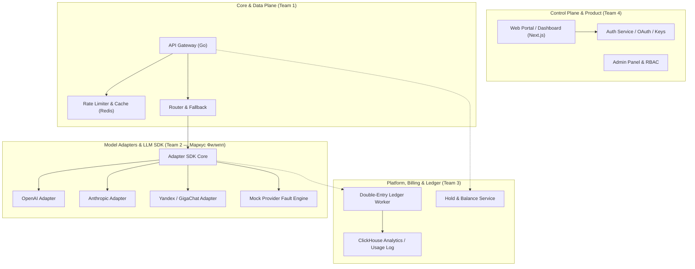

# Схема распределения команд и зон ответственности (Семинар 7)

## 1. Функциональные области платформы NeuroGateway

В процессе масштабирования разработки архитектура разделена на 4 устойчивые функциональные зоны с минимальным зацеплением (Low Coupling) и высокой связностью внутри зон (High Cohesion):

---

## 2. Команды разработки и закрепленные компоненты

### Команда 1: Core & Data Plane (Высоконагруженный шлюз)
- **Лидер / Ответственный:** Ерофеев Илья
- **Зона ответственности:** Приём внешнего клиентского HTTP/gRPC-трафика, аутентификация по API-ключам через L1/L2 кэш Redis, маршрутизация, поддержка SSE-стриминга с минимальной задержкой ($p95 < 25$ мс overhead), обеспечение отказоустойчивости при сбоях.
- **Закрепленные компоненты:** `services/gateway`, `internal/ratelimit`, `internal/cache`, `deployments/docker-compose`.
- **Эпики:** `E04` (API Gateway Data Plane), `E06` (Маршрутизация и балансировка).

### Команда 2: Model Adapters & Provider Integration (Интеграция с LLM)
- **Лидер / Ответственный:** **Маркус Филипп**
- **Зона ответственности:** Унификация работы с разнородными LLM-провайдерами. Разработка канонической схемы запросов/ответов, реализация адаптеров внешних API (OpenAI, Anthropic Messages, Gemini, YandexGPT, GigaChat, открытые модели), парсинг и валидация usage (токенов), нормализация ошибок (HTTP 429, 500, timeout), разработка mock-провайдера для контрактного тестирования.
- **Закрепленные компоненты:** `packages/contracts/publicapi`, `schema/`, `internal/mockprovider`, `services/mock-provider`, SDK адаптеров.
- **Эпики:** `E02-04` (LLM Schema), `E05` (Интеграции провайдеров), `R05/R06/R07` (Контрактные тесты отказов).

### Команда 3: Platform, Billing & Ledger (Финансы и хранение данных)
- **Лидер / Ответственный:** Деревцов Андрей
- **Зона ответственности:** Двусторонняя проводка (double-entry bookkeeping), холдирование средств перед генерацией, списание по фактическому usage, управление кошельками, миграции PostgreSQL, сбор аналитики и аудит-логов в ClickHouse.
- **Закрепленные компоненты:** `services/billing-worker`, `migrations/`, `internal/ledger`, `internal/database`.
- **Эпики:** `E07` (Биллинг и учет usage), `E10` (Аналитика).

### Команда 4: Control Plane & Developer Experience (Пользовательский контур)
- **Лидер / Ответственный:** Улитин Максим (Тимлид проекта)
- **Зона ответственности:** Личный кабинет разработчика (Next.js), управление организациями, выпуск API-ключей, витрина каталога моделей и цен, админ-панель для саппорта, транзакционные email/Telegram-уведомления, правовой контур и защита ПДн (152-ФЗ).
- **Закрепленные компоненты:** `apps/web`, `apps/admin`, `services/control-plane-api`.
- **Эпики:** `E01` (PRD и правовой контур), `E08` (Пользователи и организации), `E09` (ЛК), `E13` (Админ-панель).
