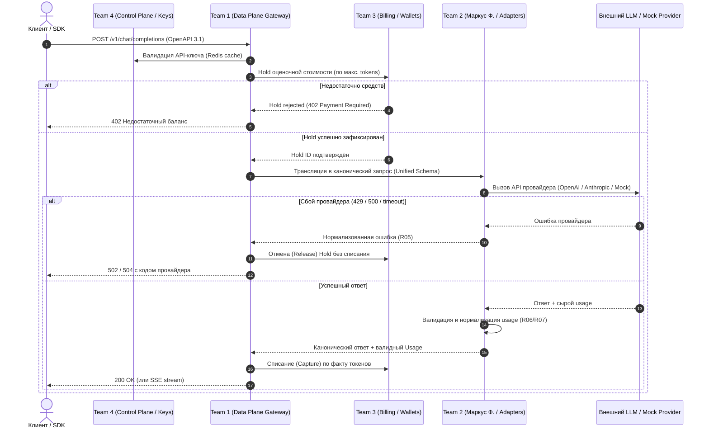

# Карта межкомандных зависимостей (Семинар 7)

## 1. Матрица межкомандных зависимостей

В таблице показано, какие артефакты и интерфейсы команды предоставляют друг другу:

| Поставщик (Команда) | Потребитель (Команда) | Передаваемый артефакт / интерфейс | Формат и протокол | Влияние на сроки (Критичность) |
|---|---|---|---|---|
| **Team 2 (Маркус Ф. / Adapters)** | **Team 1 (Core Data Plane)** | Каноническая схема LLM, интерфейс адаптера `ProviderAdapter` | Go structs / JSON Schema (`packages/contracts`) | **Критическая (Блокирующая)**: Gateway не может маршрутизировать запросы без схемы |
| **Team 2 (Маркус Ф. / Adapters)** | **Team 3 (Billing & Ledger)** | Нормализованное usage-событие (`prompt_tokens`, `completion_tokens`, `cached`) | Outbox event / Go DTO | **Критическая**: Биллинг не может рассчитать точное списание без usage |
| **Team 2 (Маркус Ф. / Adapters)** | **Team 1, 3 (Core & Billing)** | Mock-провайдер с симуляцией сбоев (429, 500, timeout) | HTTP / Docker image (`mock-provider`) | Высокая: Необходим для интеграционных CI-прогонов без внешних ключей |
| **Team 1 (Ерофеев И. / Data Plane)** | **Team 4 (Control Plane / Web)** | OpenAPI 3.1 спецификация публичного API (`/v1/chat/completions`) | OpenAPI JSON / TS client | Высокая: Генерация SDK и Playground в ЛК |
| **Team 3 (Деревцов А. / Billing)** | **Team 1 (Core Data Plane)** | API проверки баланса и создания Hold | In-memory Redis cache + PG transactional RPC | **Критическая**: Шлюз блокирует запрос при отсутствии баланса |
| **Team 4 (Улитин М. / Control Plane)** | **Team 1 (Core Data Plane)** | Репликация API-ключей и лимитов | Redis Hash / Key-Value cache | **Критическая**: Авторизация клиентских вызовов |

---

## 2. Направления потоков данных при обработке запроса

---

## 3. Критический путь интеграции и управление рисками сроков

1. **Зависимость Gateway от LLM Schema (Team 1 <- Team 2):**
   - *Риск:* Задержка выпуска Go-структур блокирует сборку ядра шлюза.
   - *Мера снижения:* Зафиксирован контракт `ID24_API-24` и заморожен на этапе Фазы F0 с 16 JSON Schema тестами.
2. **Зависимость Billing от качества usage (Team 3 <- Team 2):**
   - *Риск:* Некорректные или отрицательные токены ломают бухгалтерскую проводку в PostgreSQL Ledger.
   - *Мера снижения:* Реализована задача `ID24_API-206` (контрактные тесты качества usage отсекают невалидные данные до попадания в шину биллинга).
3. **Зависимость сквозного тестирования от боевых провайдеров:**
   - *Риск:* Блокировка аккаунтов или исчерпание баланса в OpenAI/Anthropic остановит межкомандный CI.
   - *Мера снижения:* Предоставление автономного `mock-provider` для локальных и CI-прогонов.
