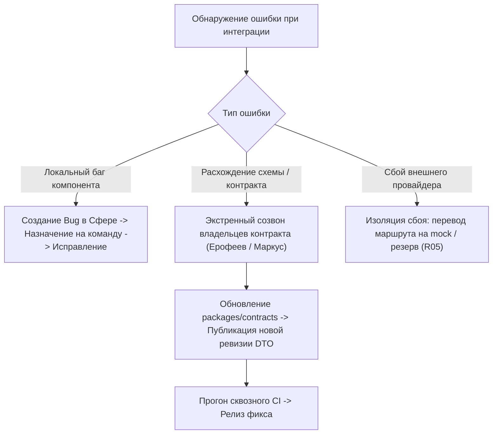

# Единые правила совместной разработки и интеграции (Семинар 7)

## 1. Единый Definition of Done (DoD) для межкомандных задач

Задача считается завершённой (`Done`), только если выполнены ВСЕ следующие критерии:
1. **Код и документация:**
   - Исходный код написан в монорепозитории в соответствии с инженерными стандартами проекта (`docs/architecture`).
   - Изменения API отражены в OpenAPI 3.1 спецификации (`packages/contracts`).
2. **Тестирование и верификация:**
   - Покрытие unit-тестами $\ge 80\%$ для критических путей (финансы, маппинг токенов).
   - Локальные контрактные тесты (`node --test tests/contracts.test.mjs`, `go test ./...`) проходят со статусом 100% PASS.
   - Межкомандная интеграция проверена против `mock-provider` без использования боевых внешних ключей.
3. **Репозиторий и CI:**
   - Код отправлен в Pull Request, CI-пайплайн полностью зелёный (`make gen lint test build`).
   - Получен аппрув от владельца зависимого компонента (peer review).
4. **Фиксация в трекере задач (Сфера Tasks):**
   - Карточка задачи в Сфере содержит структурированный отчёт: дата, автор, результат, команды проверки, ссылки на артефакты в Git, ограничения и статус приёмки.

---

## 2. Регламент работы с Git и ветками (Trunk-Based Development)

- **Основная ветка:** `main` (всегда готова к релизу и деплою на staging).
- **Ветки задач:** `feat/<task-id>-<short-name>` или `fix/<task-id>-<short-name>`.
- **Правило слияния:**
  - Запрещён прямой push в `main`.
  - Слияние только через Pull Request с squash/rebase после успешного прогона CI.
  - Изменение контрактов в `packages/contracts/` требует обязательного review владельцев смежных команд.

---

## 3. Регламент версионирования контрактов (Contract-First)

- Все межкомандные DTO и форматы сообщений хранятся в модуле `packages/contracts/`.
- Версионирование осуществляется по стандарту Semantic Versioning:
  - **PATCH**: Исправление внутренних описаний полей, не ломающее десериализацию.
  - **MINOR**: Добавление новых необязательных полей или новых эндпоинтов (обратная совместимость сохраняется).
  - **MAJOR**: Изменение обязательных полей, переименование типов, изменение семантики usage. Требует согласования на Архитектурном совете и переходного периода с поддержкой старой версии контракта.

---

## 4. Порядок устранения межкомандных дефектов и инцидентов

1. **Регистрация:** При обнаружении интеграционного дефекта создается карточка типа `Дефект` в проекте `ID24_API` с указанием блокирующей команды и ссылки на упавший тест.
2. **Арбитраж:** При технических разногласиях между шлюзом и адаптерами решение принимает Архитектурный совет (Ерофеев И. и Маркус Ф.). При разногласиях с продуктовыми требованиями решение утверждает Тимлид (Улитин М.).
3. **Zero-Blame Postmortem:** Крупные интеграционные сбои разбираются на ретроспективе спринта с обновлением контрактных тестов в `tests/contracts.test.mjs`.
